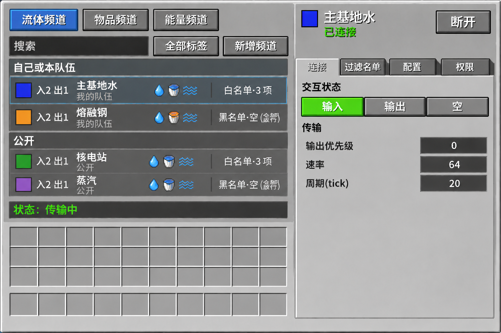
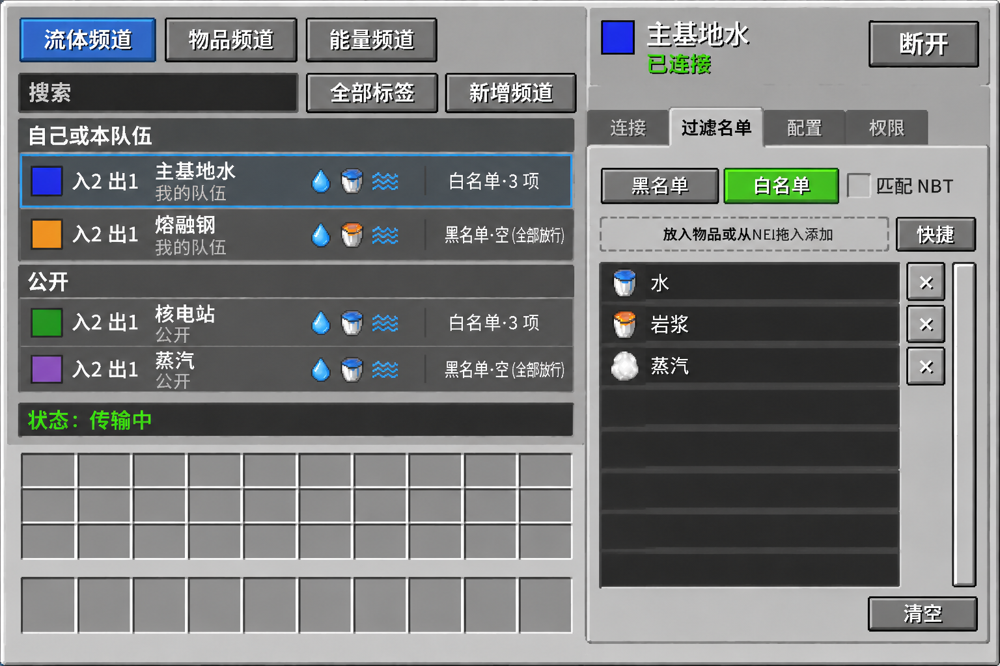
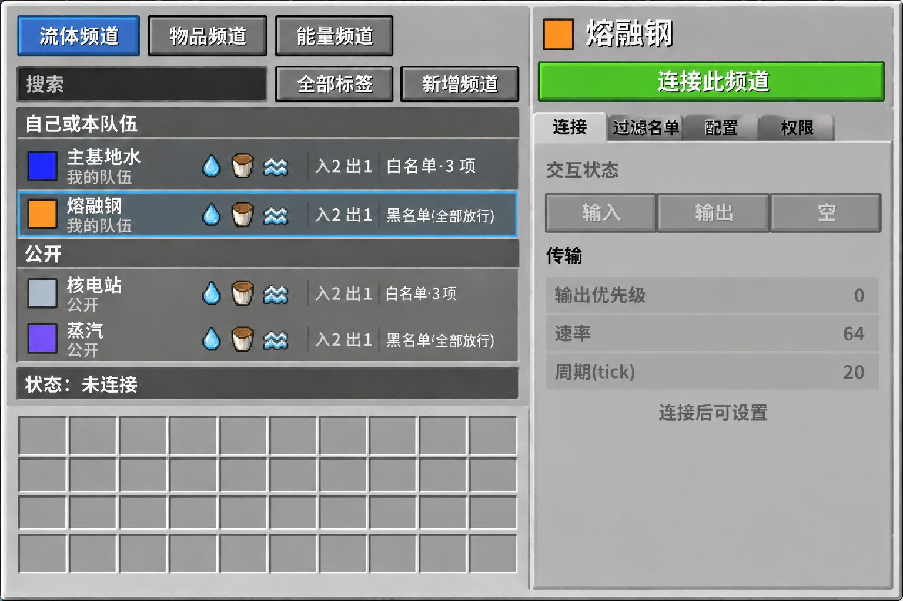

# 折跃覆盖板 GUI 重构概念图

Spec：`docs/需求文档.md`（§5）。两者冲突时以 spec 为准。

三张图是同一套布局的不同状态，一起作为依据。

## J：已连接，「连接」分页

- 回答的开放问题：频道列表和详情怎么排（同屏双栏）；本连接端和频道共享配置怎么区分（分页，「连接」页是本覆盖板自己的设置）。
- 实现时照做：
  - 左栏约 60%、右栏约 40%；右栏占满整个高度，玩家背包只在左栏下方。
  - 左栏从上到下：类型标签、搜索和按钮行、分组频道列表、状态栏、背包。
  - 右栏顶部常驻色块、频道名、连接状态、操作按钮。
  - 文件夹式分页：选中标签和内容区连成一体，未选中标签颜色更深、退到后面。
  - 「连接」页分「交互状态」和「传输」两组；传输是文字在左、数字框在右的三行。
  - 中性浅灰斜面的 GT 风格；已选中的交互状态用绿色。
- 不作依据：背包列数（按标准 9×4）；频道行「入N 出N」的位置（按 L）；频道名、图标、数值；模糊文字。
- 用户意见：通过。此前要求：分页和内容在视觉上区分开，状态开关和速率收进一个分页。
- 提示词：round-6/jobs.json 中的 `J`

## K：已连接，「过滤名单」分页

- 回答的开放问题：配置项很多时如何不超屏（分页，名单占满内容卡片）。
- 实现时照做：黑名单/白名单是分段按钮，匹配 NBT 是复选框；虚线添加区和「快捷」同一行；高条目列表带 x 和滚动条；「清空」在右下角。未选中标签的退后效果以这张为准。
- 不作依据：背包列数；频道行内容；条目图标（流体不一定画成桶）。
- 用户意见：通过。
- 提示词：round-6/jobs.json 中的 `K`

## L：未连接，「连接」分页灰显

- 回答的开放问题：如何防止误连（点频道只选中，连接要在面板顶部明确操作）。
- 实现时照做：顶部占满宽度的绿色「连接此频道」；「连接」页整页灰显并提示「连接后可设置」；频道行字段顺序（色块、频道名和归属者、最近传输图标、「入N 出N」、名单概要）；9×4 背包。
- 不作依据：概要文案（spec 是「黑名单·空（全部放行）」，图上少了「空」）；频道名、图标、数值。
- 用户意见：通过。
- 提示词：round-6/jobs.json 中的 `L`

## 需求方同时确认、图上没画的决定

已写入 spec §5.2、§5.3、§5.5：

- 去掉齿轮：点频道就打开右侧面板。
- 已连着别的频道时，顶部按钮是「切换到此频道」，直接换连，不二次确认。
- 管理器的「连接」分页改成「连接端」分页，列出所有连接端，点一行进入编辑。

## 没有定稿的部分

- 「配置」和「权限」分页没有按最终分页样式出图。内容结构参考 `round-5/H.png`（配置）和 `round-5/I.png`（权限），分页样式按 J、K。这两张不是通过稿，只作内容布局参考。
- 尺寸按现有控件粗算约 340×240，未实测，实现前要验证 GUI 缩放 3（640×360）和 4（480×270）。
